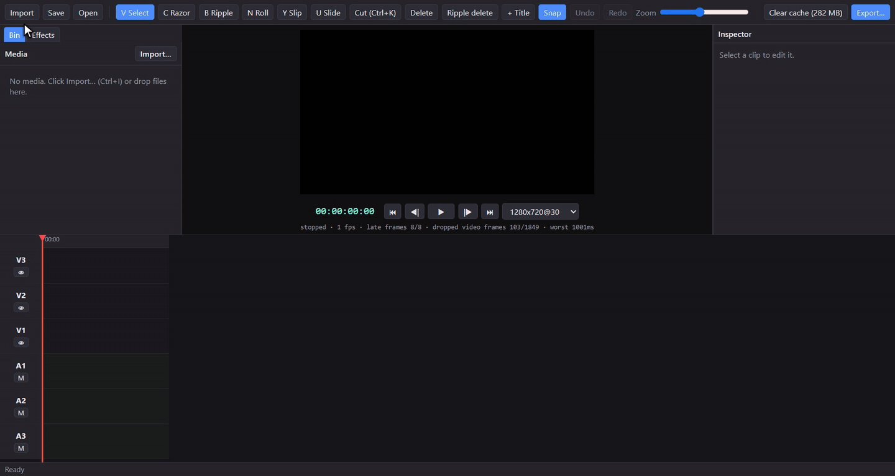
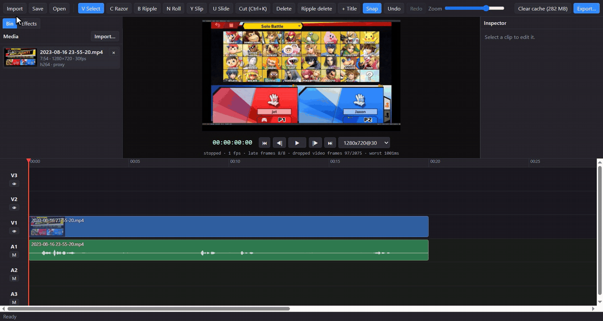
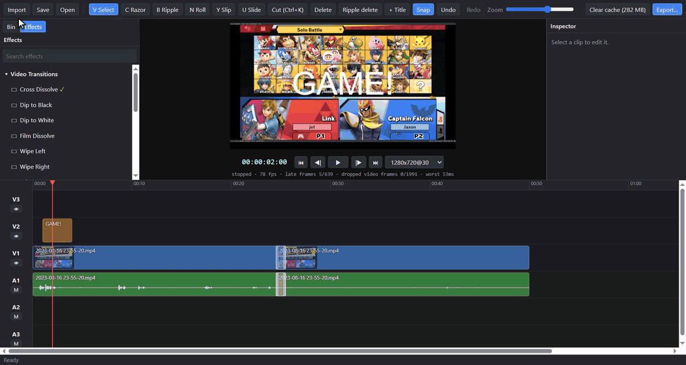
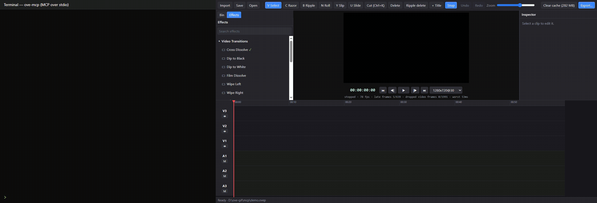

#  Open Video Editor 🎬

<p align="center">
  
</p>

A native Windows video editor for cutting down [OBS](https://obsproject.com) screen and game recordings. It's built on Electron, React and TypeScript, and uses [ffmpeg](https://ffmpeg.org) for probing, proxies and export. The preview and the export share the same math for transitions and effects, so the exported MP4 matches what you saw in the app.

It also ships a command-line tool, `ove`, and an MCP server, so an AI assistant like Claude Code can do a rough edit of a recording and open the result in the app for you to review.

## Quickstart 🚀

Requires Windows 10 or 11, x64. Nothing else needs to be installed.

1. Download `Open-Video-Editor-0.1.0-win-x64.zip` from [Releases](https://github.com/Gidntsquia/open-video-editor/releases).
2. Unzip it anywhere, e.g. `C:\Tools\Open-Video-Editor`.
3. Run `Open Video Editor.exe`.

Import recordings with Ctrl+I or by dragging them in, drag them onto the timeline, and export with Ctrl+M. Run `register-ovep.cmd` once if you want `.ovep` project files to open in the editor on double-click (`unregister-ovep.cmd` removes it).

IMPORTANT: the zip isn't code-signed, so Windows SmartScreen may warn on first run. Click "More info", then "Run anyway".

## Development 🛠️

Requires Node 22.12+ (Electron 44 needs it to install) and Git.

```
git clone https://github.com/Gidntsquia/open-video-editor
cd open-video-editor
npm.cmd install     # Downloads Electron and a static ffmpeg (~250 MB)
npm.cmd start       # Builds the UI and opens the app
```

Use `npm.cmd`, not `npm`: PowerShell's default execution policy blocks `npm.ps1`.

```
npm.cmd test        # Export, CLI, transition and MCP tests (needs ffmpeg on PATH)
npm.cmd run dist    # Builds release/Open-Video-Editor-<version>-win-x64.zip
```

## Features 🔬

- Imports mp4, mov and mkv in H.264 or HEVC. HEVC, very large and high-bitrate files get a smaller proxy for playback automatically.
- Three video and three audio tracks, with razor, ripple, roll, slip and slide tools and Premiere-style shortcuts.
- 14 video transitions (dissolves, dips, wipes, pushes, cross zoom) and 3 audio crossfades.
- The inspector covers titles, volume, fades, volume keyframes, brightness/contrast/saturation, crop, scale, position and speed.

<p align="center"></p>

- Exports H.264 + AAC MP4. NVENC is used when an NVIDIA GPU is present, otherwise x264, and a budget setting lets the export run in the background at low priority.
- Thumbnails, waveforms, proxies and temp files go to a 2 GB `cache` folder next to the exe, with a Clear cache button. Source media is never modified.

<p align="center"></p>

## ove CLI ⌨️

`ove` finds scenes, silences, loud moments and transcripts in a recording, builds a `.ovep` project from a list of commands, and renders frames or a 480p preview to check it. From the unzipped folder, `ove.cmd help` lists the commands; from a source checkout it's `npm.cmd run ove -- help`.

## MCP server 🤖

The MCP server exposes every `ove` command as a tool and reloads the project in the running app after each edit.

<p align="center"></p>

For Claude Code, put this in `.mcp.json` in your project folder, with your unzip path:

```
{ "mcpServers": { "ove": { "command": "cmd", "args": ["/c", "C:\\Tools\\Open-Video-Editor\\ove-mcp.cmd"] } } }
```

A source checkout already has a `.mcp.json` that runs `node cli/mcp.js`.

## Documentation 📚

More details in the
[wiki](https://github.com/Gidntsquia/open-video-editor/wiki):

- [Editing](https://github.com/Gidntsquia/open-video-editor/wiki/Editing) — shortcuts, bin, transitions, export settings
- [ove CLI](https://github.com/Gidntsquia/open-video-editor/wiki/Ove-CLI) — commands, batches, caching, GPU transcripts
- [MCP Server](https://github.com/Gidntsquia/open-video-editor/wiki/MCP-Server) — Claude Code setup and app control
- [Development](https://github.com/Gidntsquia/open-video-editor/wiki/Development) — tests, packaging, releases, credits

## License 📄

[MIT](LICENSE). The ffmpeg binaries come from `ffmpeg-static` and `ffprobe-static` and are licensed LGPL/GPL by the FFmpeg authors; the release zip includes them.
